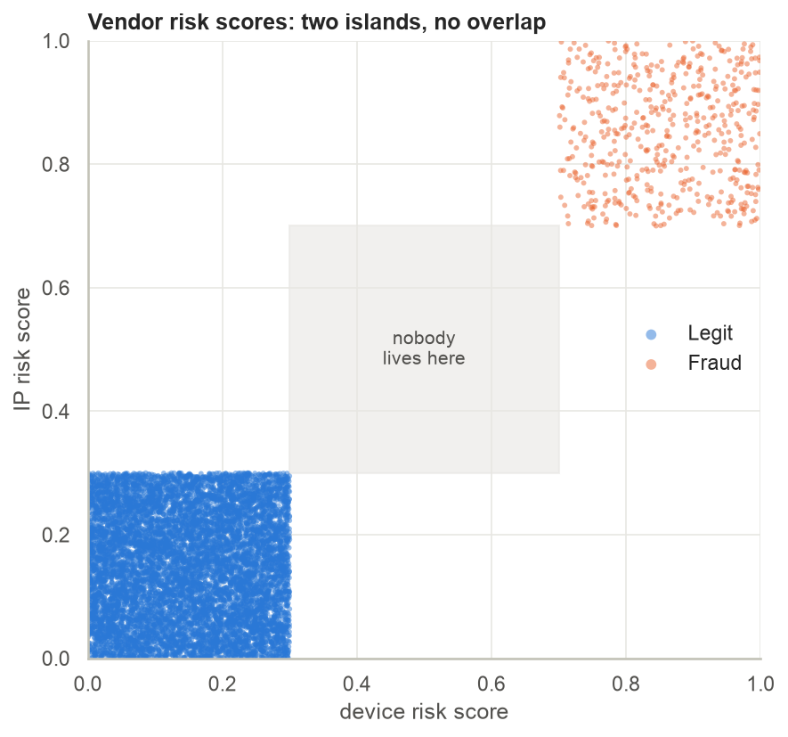
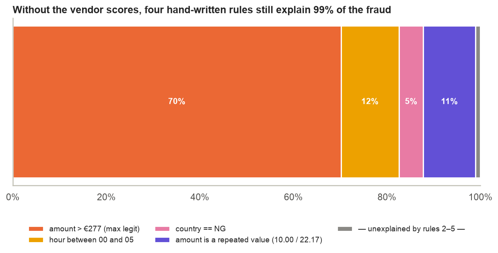
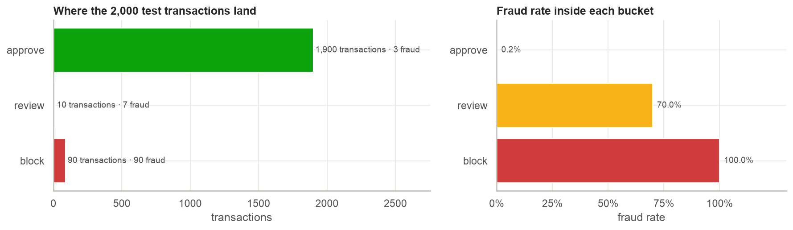

# Fraud Detection, Done Honestly

> A first pass at this dataset scored a ROC-AUC of **1.0**. This project treats that number as a crime scene rather than a result: it shows the data leaks its labels in five independent ways, fixes two methodological bugs, builds the realistic version of the problem, and wraps the model in the decision, explanation and monitoring machinery that turns a probability into money saved.

| | |
|---|---|
| **Notebook** | [`proj.ipynb`](proj.ipynb) · static version: [`reports/fraud_detection_report.html`](reports/fraud_detection_report.html) |
| **Data** | [Synthetic Financial Fraud Dataset](https://www.kaggle.com/datasets/umitka/synthetic-financial-fraud-dataset) (Kaggle) · 10,000 transactions · 5 % fraud · fully synthetic |
| **Stack** | Python 3.12 · scikit-learn · SHAP · XGBoost / LightGBM · FastAPI · Streamlit · pytest |



## What the project finds

**1. The "perfect" model is a one-liner.** Every fraud has both vendor risk scores above 0.70 and every legitimate transaction has both below 0.30. The rule `device_risk_score > 0.5` is a perfect classifier. Those columns are an answer key, not features.

**2. Four more artefacts explain the rest.** Without the vendor scores, four hand-written rules still catch 99 % of fraud with zero false positives: an amount above the legitimate ceiling (no legit purchase exceeds €277), a night-time hour (00–05h contains *only* fraud), country = Nigeria (100 % fraud), and an amount of exactly €10.00 or €22.168429 (a generator artefact repeated 133 times).



**3. The original notebook had two leaks of its own.** Fraud-rate encodings were computed on the full dataset (test labels leaked into test features) and a second, unstratified split silently overwrote the stratified one. The notebook demonstrates how a leaky target encoding manufactures a 0.86 ROC-AUC from a column (`user_id`) that carries no information (0.50 when encoded correctly).

**4. Hard mode: fraud detection without the answer key.** With the vendor scores removed, gradient boosting reaches PR-AUC ≈ 0.99 on held-out data, but its remaining errors sit exactly at the artefact boundaries, where real-world performance would be far lower. User-behaviour features (built leakage-free with leave-one-out) add nothing here, because fraud in this data is assigned to transactions, not to people, which a Poisson check predicts in advance.

**5. Thresholds come from a cost model, not a default.** With a €5 review cost and losses of *amount + €15* per missed fraud, the cost-optimal review threshold is 0.04, not 0.5. On 2,000 test transactions, doing nothing loses ~€187k; the cost-optimal policy loses €775; a three-way approve / review / block policy loses €325.



**6. The system is explainable, stress-tested and monitored.** SHAP reason codes accompany every flagged transaction. The model degrades gracefully as the vendor score gets noisier, tolerates 10 % label noise, and its policy is insensitive to the exact review cost. A PSI drift check guards production traffic.

### Hold-out results (2,000 transactions, thresholds chosen out-of-fold on the training set)

| Model | PR-AUC | ROC-AUC | Precision | Recall | Review ≥ | Block ≥ |
|---|---|---|---|---|---|---|
| `full` (with vendor scores) | 1.000 | 1.000 | 1.000 | 1.000 | 0.28 | 0.30 |
| `hardmode` (without) | 0.991 | 0.999 | 0.970 | 0.980 | 0.08 | 0.98 |
| analyst rules (no model) | – | – | 1.000 | 0.880 | – | – |

## Repository layout

```
proj.ipynb                     the narrative: EDA → forensics → hard mode → decisions → SHAP → stress tests → ship
src/fraud_detection/           the package everything else imports
  features.py                  BasicFeatures, UserProfileEncoder (leave-one-out, unknown-user fallback)
  pipeline.py                  build_pipeline(model, mode="full"|"hardmode"), candidate models
  costs.py                     CostModel, cost curves, two- and three-way threshold optimisation
  explain.py                   ReasonCoder: SHAP → three plain-language reason codes
  drift.py                     Population Stability Index report
  training.py                  train_and_export(): OOF thresholds → hold-out eval → refit → model card
  evaluation.py, viz.py        CV comparison helpers, colour-blind-safe plot defaults
scripts/train.py               reproduce models/ and the model card
scripts/score_batch.py         score a CSV offline with decisions + reason codes
scripts/check_drift.py         PSI guard (exit 1 on severe drift) for cron / CI
app/api.py                     FastAPI: /score, /score/batch, /model-card, /health
app/dashboard.py               Streamlit analyst console: triage queue, what-if costs, inspector
tests/                         13 tests: leave-one-out logic, pipelines, cost model, API
models/                        fraud_pipeline_{full,hardmode}.joblib + model_card.json
reports/                       HTML export of the notebook + every figure as PNG
```

### Graceful degradation by design

Two models are shipped. The API uses `full` when a request carries both vendor scores and falls back to `hardmode` when it does not (vendor outage, new market with no coverage), and tells you which one it used:

```json
POST /score
{"user_id": 42, "amount": 1850, "transaction_type": "Online", "merchant_category": "Electronics", "country": "DE", "hour": 3}

→ {"fraud_probability": 0.9998, "decision": "block", "model_used": "hardmode",
   "reason_codes": [{"label": "amount", "value": 1850.0, "contribution": 13.46, "direction": "raises risk"}, ...]}
```

## Getting started

```bash
# environment (conda) – or: pip install -r requirements.txt && pip install -e .
conda env create -f environment.yml
conda activate fraud-detection
python -m ipykernel install --user --name fraud-detection --display-name "Python (fraud-detection)"

make train        # models/ + model card            (~10 s)
make test         # pytest                          (13 tests)
make notebook     # execute proj.ipynb in place     (~2 min)
make report       # reports/fraud_detection_report.html
make api          # http://127.0.0.1:8000/docs
make dashboard    # Streamlit analyst console

python scripts/score_batch.py new_transactions.csv scored.csv
python scripts/check_drift.py new_transactions.csv
```

## Cost assumptions

All thresholds derive from `CostModel` (`src/fraud_detection/costs.py`). The defaults are deliberately exposed as parameters, and the dashboard has sliders for them.

| Event | Cost |
|---|---|
| Manual review of a flagged transaction | €5 |
| Fraud approved (missed) | amount + €15 chargeback fee |
| Legitimate customer blocked outright | €25 |

## Limitations and next steps

* **No timestamps**, so velocity features (transactions per user per hour, time since last) could not be built, and the split is random rather than temporal. On real data both matter more than anything here.
* **No shared entities** (devices, IPs, merchants), so fraud-ring / graph features are out of reach.
* **Selective labels**: in production only reviewed transactions get confirmed labels; periodic random audits or inverse-propensity weighting are needed before retraining on feedback.
* **Latency**: the pipeline scores in ~6 µs per row in batch; a real-time authorisation path would move the user-profile lookup into a feature store.

The through-line: *a perfect score is a question, not an answer.*
